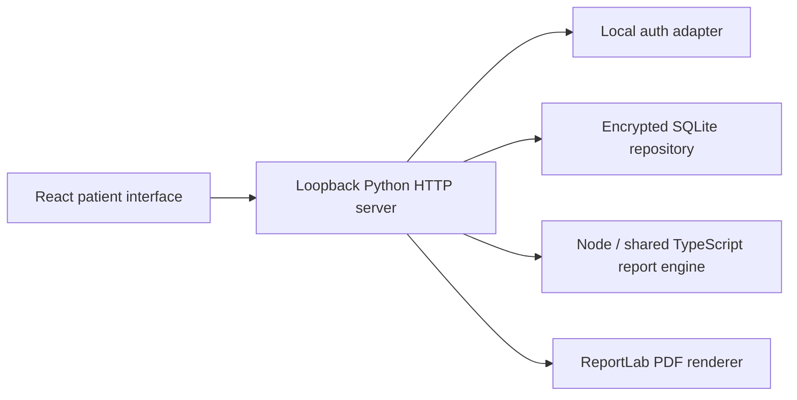

# Local application architecture

This document describes the current implementation. See [database design](SQLITE_DESIGN.md)
for persistence and [development](DEVELOPMENT.md) for running and reviewing changes.

## Runtime

`npm start` and `npm run api` compile the frontend and start the Python server at
127.0.0.1:8765. The server serves `dist` and `/api` from the same origin. HashRouter
handles client navigation. Stale or missing frontend builds produce a setup page
instead of silently serving an older interface. Developer-only Vite uses 5173
and proxies `/api` to the backend; preview uses 4173.

## Components

| Location | Responsibility |
|---|---|
| `src/App.tsx` | Auth gating, app shell, onboarding routes, inactivity lock, reminders |
| `src/ui/store.ts` | In-memory record/session state and local API requests |
| `src/ui/screens/` | Patient, trial, logging, history, insight, report, and privacy screens |
| `src/engine/` | Cycles, features, statistical patterns, report claims, fidelity checks |
| `src/engine/local-report.ts` | Server-invoked report engine with scope filtering |
| `shared/symptoms.json` | Vocabulary shared by collection, validation, and analysis |
| `backend/server.py` | HTTP routing, request boundaries, ownership, exports, documents |
| `backend/local_auth.py` | Local account, password, recovery, session, and trial lifecycle |
| `backend/local_key.py` | Installation key protection |
| `backend/local_reports.py` | Trusted report computation and PDF generation |
| `backend/medtrace_db/` | Migrations, encrypted payloads, validation, and repository operations |

## Authentication and request boundaries

Accounts use scrypt password hashes with random salts. Session cookies are HttpOnly,
SameSite=Strict, and scoped to `/api`. Session tokens and recovery codes are stored
as hashes. The server resolves a subject from the session and maps it to a clinical
patient ID; clients cannot select another account's patient ID.

Sessions last at most 12 hours and expire after 30 minutes of inactivity. The UI
keeps active sessions alive while the user is interacting and locks inactive ones.
Passwords can be changed or reset locally, invalidating other sessions. Login and
recovery attempts are rate-limited in process memory.

The server binds only to loopback and restricts Host and Origin. JSON mutations need
an application header and a session-bound CSRF token, except initial authentication
requests. Request bodies are limited to 8 MB. Responses disable caching; request
logs are disabled. Audit entries contain action names and timestamps, not health text.
HTTP is used on loopback; this is not a public-network deployment configuration.

## Analysis and reports

Browser insights use the deterministic engine. Clinical reports are recomputed on
the server through the locally installed `tsx` runner. There is no model call or
API key. Unknown observations are excluded from symptom denominators. Statistical
findings are gated by evidence quality and multiplicity correction; a separate
fidelity implementation rechecks numeric assertions.

Selected symptom domains and inclusion flags are applied before report computation.
Cycle context can use observations outside the display window for retrospective
alignment; scoped source evidence is stored privately with the report. Attachments
are never automatically shared. Private notes/episode details are opt-in.

The server stores an encrypted one-hour preview bound to a record revision. Approval
requires explicit review, current analysis/export permissions, and an unchanged
revision. Approved snapshots are immutable during ordinary logging. Domain erasure
and account deletion can remove snapshots. PDFs are generated on demand.

Local visit links refer to approved PDFs, store token hashes, have expiry and
revocation, and check current export permission on every access. They do not expose
source-record JSON or make this computer remotely reachable.

## API reference

All paths below are relative to `/api`. Account-owned routes require a session.
Mutations require CSRF once authenticated. Exact request validation is in `server.py`.

| Method | Path | Purpose |
|---|---|---|
| GET | `/health` | Local service metadata |
| GET | `/auth/session` | Session and owned record, or signed-out state |
| POST | `/auth/register`, `/auth/login`, `/auth/recover` | Local credentials and recovery |
| POST | `/auth/trial` | Create an isolated fictional trial |
| GET | `/auth/ping` | Active session keepalive |
| POST | `/auth/logout` | End a session; delete trial data |
| GET / PUT | `/record` | Read/save the owned record with expected revision and request UUID |
| POST | `/trial/scenario` | Replace only a trial's working example |
| POST | `/consents` | Append a purpose decision |
| POST | `/reports/preview` | Compute a scoped report draft |
| GET / POST | `/reports` | List snapshots / approve a reviewed draft |
| GET | `/reports/{id}`, `/reports/{id}/pdf` | Owned snapshot / approved PDF |
| GET / POST | `/shares` | List / create local visit grants |
| POST | `/shares/revoke` | Revoke an owned grant |
| GET | `/shared/{token}` | Download an approved PDF through an active grant |
| GET / POST | `/attachments` | List / upload event documents |
| GET / DELETE | `/attachments/{id}` | Download / remove an owned document |
| GET | `/audit`, `/export` | Activity history / personal JSON export |
| POST | `/privacy/erase-domain` | Confirmed structured domain erasure |
| POST | `/account/password` | Change password and revoke other sessions |
| DELETE | `/account` | Confirmed account and associated data deletion |

Conflicts return 409; missing sessions return 401; permission failures return 403;
invalid input returns 400; missing feature dependencies return 503. Successful writes
use committed revisions so stale tabs cannot silently overwrite new records.

## Encryption, portability, and limits

AES-256-GCM protects clinical payloads with random nonces and associated data bound
to the patient and record identity. SQLite metadata remains readable; the database
file is not wholly encrypted. Windows DPAPI protects the random installation key
under the current Windows user. An explicit `MEDTRACE_LOCAL_KEY` process environment
variable is supported for other operating systems; npm launch commands currently
target Windows.

Keep the same key for an existing database. Back up the key and database together
while the app is stopped. DPAPI-protected copies cannot simply be moved to a different
Windows user. JSON export is plain data, not an encrypted restoration mechanism.

Cloud identity/storage, cross-device sync, remote hosted sharing, generative AI,
native notifications, automated backup import, and clinical outcome validation are
outside this version. A later Supabase auth adapter can resolve the same repository
subject boundary; no Supabase dependency is currently active.
