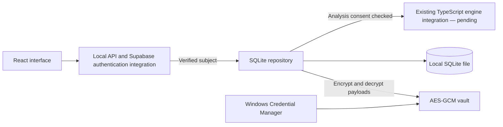
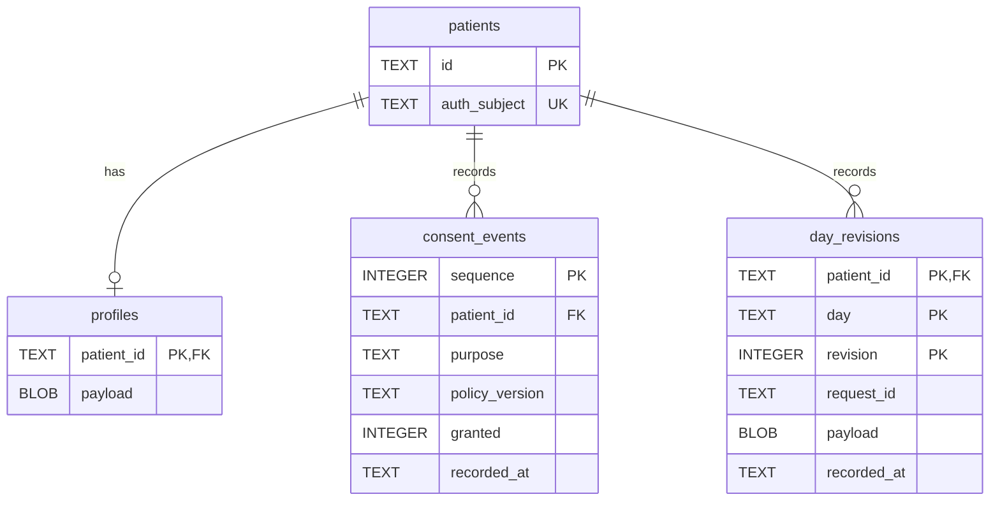

# SQLite database design

Status: implemented foundation, schema version 1. This document describes the code
in `backend/medtrace_db/database.py` and `backend/medtrace_db/crypto.py`. Future
entities are listed separately; this is not the complete production schema.

## Architecture and responsibility

The application runs locally. Python's standard `sqlite3` driver reads and writes
the database file; no PostgreSQL service, S3 bucket, or ORM is required for this
foundation. The database layer owns persistence, payload encryption, consent
checks, patient scoping, and daily-entry revisions.

The authentication teammate owns Supabase login, JWT verification, sessions, and
refresh tokens. Every repository operation receives the verified JWT `sub`, which
must be a UUID. The repository normalizes it and resolves a local patient UUID.
It does not verify JWTs itself: UUID validation is not authentication. The API must
never take this subject from a client-selected request field.



## Entity relationships



All columns are required, except that SQLite's generated integer primary key is
supplied by SQLite. UUIDs are stored as canonical text. Foreign keys reference
`patients.id` and use `ON DELETE CASCADE`. There is no public deletion method yet;
the cascade is schema behavior, not a complete data-erasure workflow.

## Tables and constraints

### `patients`

| Column | Meaning | Constraint |
|---|---|---|
| `id` | Locally generated pseudonymous patient UUID | Primary key |
| `auth_subject` | Verified Supabase user UUID | Required, unique |

`create_patient()` is idempotent for the subject and returns the existing local ID
on repeated calls. Provisioning the identity mapping does not collect a clinical
profile and does not require health-storage consent.

### `profiles`

| Column | Meaning | Constraint |
|---|---|---|
| `patient_id` | Owning patient | Primary key and foreign key |
| `payload` | Encrypted JSON profile | Required BLOB |

Only one current profile is stored per patient. Saving replaces its encrypted
payload; **profile history is not implemented**. The repository requires a mapping
and rejects top-level `id` and `auth_subject` overrides. Detailed profile fields
and optional-module permissions still need validation.

### `consent_events`

| Column | Meaning | Constraint |
|---|---|---|
| `sequence` | Global database insertion order | Auto-increment primary key |
| `patient_id` | Owning patient | Foreign key |
| `purpose` | Processing purpose | Repository allowlist |
| `policy_version` | Version presented to the patient | Repository rejects blank text |
| `granted` | Grant (`1`) or withdrawal (`0`) | SQL check allows only 0 or 1 |
| `recorded_at` | Server-generated UTC ISO timestamp | Required text |

Index: `consent_lookup(patient_id, purpose, sequence)`.

The repository appends decisions and determines current consent using the greatest
sequence for a patient/purpose. This avoids using wall-clock timestamps to order
decisions. No update/delete methods exist for consent events, but direct SQL can
modify them: append-only behavior is a repository contract, not a SQL trigger.

### `day_revisions`

| Column | Meaning | Constraint |
|---|---|---|
| `patient_id` | Owning patient | Foreign key, composite primary key |
| `day` | Patient's symptom calendar day (`yyyy-mm-dd`) | Composite primary key |
| `revision` | Revision number, starting at 1 | Composite primary key, SQL check > 0 |
| `request_id` | Client-generated operation UUID | Unique together with patient ID |
| `payload` | Encrypted complete daily entry | Required BLOB |
| `recorded_at` | Server-generated UTC ISO timestamp | Required text |

Primary key: `(patient_id, day, revision)`.

The primary-key index supports patient/date reads and revision lookup. The unique
index on `(patient_id, request_id)` supports safe retries. There is no separate
current-entry table: the maximum revision for each day is current.

## Clinical payloads and missing data

Clinical fields live inside authenticated encrypted JSON payloads. This keeps
symptom names, severity, notes, bleeding, and functional impact out of readable
SQLite columns while preserving the existing engine's `DayRecord` structure.
Analytics decrypts the selected records in application memory; SQL cannot filter
by symptom severity inside these encrypted payloads.

Example daily payload:

```json
{
  "date": "2026-10-02",
  "logged": true,
  "bleeding": "none",
  "impact": 2,
  "depth": "standard",
  "symptoms": {
    "pelvic_pain": {"state": "present", "severity": 7},
    "fatigue": {"state": "unknown"},
    "back_pain": {"state": "absent"}
  }
}
```

Rules enforced by `validate_day()`:

- Date must be a canonical ISO calendar date and `logged` must be exactly `true`.
- Bleeding, when provided, is `none`, `spotting`, `light`, `moderate`, `heavy`, or
  `very_heavy`.
- Impact, when provided, is an integer from 0 through 3; booleans are rejected.
- Depth, when provided, is `quick`, `standard`, or `detailed`.
- Symptoms are a mapping of nonempty string identifiers to observations.
- Each observation explicitly states `present`, `absent`, or `unknown`.
- Optional severity must be an integer 1–10 on a present observation. A zero answer
  becomes `absent` without a severity field; absent/unknown cannot carry severity.

Missing symptom keys mean unknown to the consuming engine. Missing calendar days
have no row and are not filled with zero observations. Patient-local dates and UTC
recording timestamps serve different purposes; timezone preferences are not yet
persisted as a separately validated schema field.

Other payload fields, including notes, medication entries, and impact domains, can
be retained as JSON but do not yet receive dedicated validation. The symptom
catalogue is not yet checked against IDs, and sensitive-module gating is pending.

## Consent enforcement

| Purpose | Currently enforced at |
|---|---|
| `health_storage` | `save_profile()` and `save_day()` |
| `health_analysis` | `analysis_days()` |
| `external_ai` | Decision can be recorded; no external AI implementation |
| `report_export` | Decision can be recorded; no report export implementation |

No decision or a latest withdrawal raises `ConsentRequired` for the relevant
operation. The checks run within the write/analysis transaction. Existing patient
records remain readable through `read_profile()` and `read_days()` after withdrawal
for patient access. Callers must use `analysis_days()` for analysis instead of
bypassing its check using ordinary reads. Withdrawal does not erase earlier data.

Current consent checking uses the latest decision, without matching a required
policy version. Re-consent after policy changes, actor/source metadata, deletion,
and downstream cached-analysis invalidation remain to implement.

## Daily write and read lifecycle

1. Validate the complete entry, expected revision, and request UUID.
2. Begin an immediate transaction and resolve the verified subject to its patient.
3. Require current health-storage consent.
4. If the request UUID already exists for that patient, decrypt and compare its
   payload. An identical retry returns that operation's original revision; a
   different payload raises `Conflict`.
5. Otherwise compare the supplied `expected_revision` with the latest day revision
   (0 for a new day). A stale version raises `Conflict`.
6. Increment the revision, encrypt with its patient/date/revision context, insert
   the row, and commit. Errors roll the transaction back.

Entries are full replacements, not patches. Omitting a previously observed symptom
in a correction makes it unknown in the new current entry; the historical entry
remains available in the underlying revision table. There is no history-read
repository method yet. A retry of an older operation returns its original revision
even if a later revision exists, so reload current state before another edit.

`read_days()` selects the latest revisions within an inclusive date range, ordered
by day. It returns `[{"revision": 1, "entry": {...}}]`. `analysis_days()` returns
only the entry objects after checking analysis consent.

## Encryption and keys

Algorithm: AES-256-GCM through the `cryptography` library. JSON is serialized with
stable key ordering, compact separators, and non-finite numbers disallowed.
Each encryption uses a fresh cryptographically random 12-byte nonce.

Stored envelope:

| Byte range | Contents |
|---|---|
| 0–3 | Key version, unsigned big-endian integer |
| 4–15 | 12-byte nonce |
| 16 onward | Ciphertext and GCM authentication tag |

Associated data is the UTF-8 context followed by the four-byte key-version header:

- Profile context: `profile:{patient_id}`.
- Day context: `day:{patient_id}:{date}:{revision}`.

Binding prevents encrypted records from being substituted across these contexts.
It does not prevent a privileged attacker from deleting rows or replaying an old
profile ciphertext under the same profile context. No global integrity ledger is
implemented.

`Vault` receives a key-version mapping and an active version. Writes use the active
key; reads choose the version in the envelope. Unknown versions fail; wrong keys or
tampered ciphertext fail authentication. Keeping historical keys allows reads
after rotation, but bulk re-encryption is not implemented.

`load_os_key()` requires Windows Credential Manager through `keyring` and rejects
other backends. First-time key creation must be explicit; later opens must fail if
the key is missing rather than create a replacement. Use a stable installation/key
identifier. Keys are independent of Supabase sessions and never stored in SQLite.
No key recovery, backup-key wrapping, or non-Windows implementation exists yet.

**Encryption boundary:** this is standard SQLite with encrypted clinical payloads,
not SQLCipher full-file encryption. Patient IDs, Supabase subject mappings, dates,
revision/request metadata, consent decisions, and schema are readable. The OS user
and a process holding the key can decrypt payloads. File encryption, file permissions,
backup protection, and retention controls remain prerequisites for real patient use.

## Connections and migrations

- Connections enable foreign keys and a 5-second busy timeout.
- Repository transactions use `BEGIN IMMEDIATE`, `COMMIT`, and rollback on errors.
- Use a connection on its owning thread; do not share it across FastAPI threads.
- Reads outside `analysis_days()` do not take a repository write transaction.
- WAL is not explicitly enabled. The SQLite driver's default journal configuration
  applies; database file copying during active writes is not a supported backup plan.
- `PRAGMA user_version` identifies the schema version. On open, missing migrations
  execute in order in one transaction. Version 1 creates the four tables and index.
- A database newer than the supported version is rejected. Add future migrations
  after existing ones; do not change a migration that deployed databases have applied.
- No downgrade, backup, or restore command is implemented.

## Integration interface

| Method | Contract |
|---|---|
| `create_patient(subject)` | Provision or return local patient UUID |
| `record_consent(subject, purpose, policy_version, granted)` | Append a decision |
| `save_profile(subject, profile)` | Replace encrypted profile after consent check |
| `read_profile(subject)` | Return profile or `None` |
| `save_day(subject, day, expected_revision=..., request_id=...)` | Save/retry entry and return revision |
| `read_days(subject, start, end)` | Read current entries and revisions |
| `analysis_days(subject, start, end)` | Read engine entries after analysis consent check |
| `close()` | Close the connection |

`ConsentRequired` is a permission error; `Conflict` is a value error used for stale
revisions and mismatched retries. Invalid inputs can raise `ValueError`, `KeyError`,
or `TypeError`; a typed request schema and consistent HTTP error translation are
still required at the API boundary. Cryptographic errors must not be hidden by
returning empty records or logging sensitive payloads.

## Verification and next schema work

The 12-test suite in `backend/tests/test_database.py` verifies reopen persistence,
payload encryption, tamper/substitution rejection, key-version reads, consent
withdrawal, separate analysis consent, patient isolation, retries, stale edits,
revision retention, invalid observations, missing days, and schema-version handling.
Tests use temporary files and ephemeral keys; OS Credential Manager and live
Supabase authentication are not tested.

Next additions are patient preferences and optional-module enforcement, validated
symptom vocabulary, medication/treatment/clinical-event storage, detailed episodes,
analysis runs, immutable report claims and evidence references, export/deletion,
audits, encrypted backups, and full-file encryption. Hosted sharing and file uploads
are deferred. Existing frontend localStorage remains a separate synthetic-data
prototype until API integration is completed.
